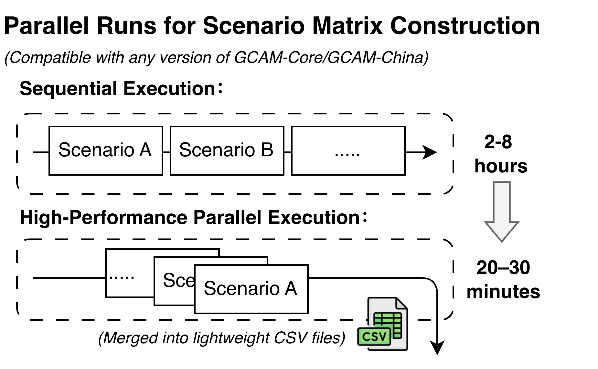

# GCAM High Performance Computing Cluster for PKU



BUILD · RUN · QUERY

This guide describes the PKU HPC workflow for building GCAM, expanding and
running scenario ensembles, executing a preconfigured QUERY set for every
scenario, and merging the resulting CSV files. Official QUERY remains the
default; an optional gcamreport container exports IAMC CSVs for shell merging.

The same toolkit works with **any version of `gcam-core` or `gcam-china`** — pick the release you want from upstream and the tools auto-detect the variant.

---
Visit this [Wiki](https://github.com/jerrysong0128/gcam-hpc-PKU/wiki)

## Quickstart

1. Clone this repo somewhere on the cluster, e.g. `~/GCAM_Workspace/gcam-hpc-PKU`.
2. Download the required GCAM source package on your local computer:

   - gcam-core: <https://github.com/JGCRI/gcam-core/releases>
   - gcam-china: <https://github.com/umd-cgs/gcam-china/releases>

   GitHub downloads can be unreliable from the HPC login nodes. Download the
   release archive through a browser, upload it to the repository root on the
   cluster, and extract it there. The resulting source directory must contain
   `cvs/objects/build/linux`; directories such as `gcam-core/`,
   `gcam-core-v8.2/` and `gcam-china-dev/` are detected automatically. Keep
   only one matching GCAM source directory in the workspace, or set `GCAMDIR`
   explicitly before sourcing the environment.
3. Prepare the bundled HPC dependencies:

   ```bash
   cd gcam-hpc-tools/build-tools
   unzip gcam-hpc-pku-libs.zip
   unzip archive/libs.zip
   ```

   The second archive creates the required `build-tools/libs/` directory:

   ```text
   libs/
   ├── boost-lib/
   ├── eigen/
   ├── jars/
   ├── java_linux/
   └── tbb-linux/
   ```

   Verify the extraction before continuing:

   ```bash
   test -d libs/boost-lib &&
   test -d libs/eigen &&
   test -d libs/jars &&
   test -d libs/java_linux &&
   test -d libs/tbb-linux
   ```
4. Edit two lines in `gcam-hpc-tools/build-tools/environment.sh`:

   ```bash
   export GCAM_HPC_WORKSPACE=/absolute/path/to/gcam-hpc-PKU
   export GCAM_HPC_CLUSTER=wm2     # or wm1, or a custom profile you add
   ```
5. Source it once per shell:
   ```bash
   source $GCAM_HPC_WORKSPACE/gcam-hpc-tools/build-tools/environment.sh
   ```
   This exports everything the build and run flows need (`GCAMDIR`, `TOOLDIR`,
   `SCRATCHDIR`, dependency paths and `SLURM_TEMPLATE`). No compatibility setup
   scripts are required.

To support a new site, copy `build-tools/profiles/custom.profile` to `<yoursite>.profile`, fill in the paths, and set `GCAM_HPC_CLUSTER=<yoursite>`.

## Step BUILD

```sh
source $GCAM_HPC_WORKSPACE/gcam-hpc-tools/build-tools/environment.sh
cd "$GCAM_LIB"
make clean
make gcam -j 16
```

## Step RUN

Configure QUERY first, then run the scenario pipeline. With the bundled GCAM
8.2 example:

```sh
"$TOOLDIR/run-pipeline.sh" \
    "$TOOLDIR/configuration-sets/config/v82_default/v82_default_scenario_components.xml" \
    "$TOOLDIR/configuration-sets/config/v82_default/v82_default_batch_2.xml"
```

Running without arguments selects these same defaults. `run-pipeline.sh`
synchronizes GCAM inputs and the prepared QUERY files into `gcam-scratch/`,
expands one configuration per scenario, writes
`run-tools/slurm-templates/generated-run.slurm`, and submits the RUN and
dependent merge jobs after confirmation.

## Step QUERY

Official QUERY is the default. The optional gcamreport flow is:
**GCAM → IAMC CSV per scenario → shell merge into one CSV**. Containerized R
reads the scenario's BaseX database, detects the model version, and calls
`gcamreport::generate_report()` to map variables and convert units to IAMC format
(`Model,Scenario,Region,Variable,Unit,<years>`).

Prepare the container once on an internet-connected **Linux x86_64** build
machine with rsync, curl, jq and Apptainer/Singularity (no Python required).
PKU login nodes are for job submission; use a permitted networked build
machine for preparation, then place the SIF in `containers/gcamreport/`:

```bash
cd /path/to/gcam-hpc-PKU
git submodule update --init --recursive
bash gcam-hpc-tools/query-tools/reporting/prepare-container.sh
```

Preparation uses the pinned upstream R/Java image and the checked-out
gcamreport submodule. It uses Docker when available, otherwise a user-owned
sandbox requiring neither Docker nor sudo/fakeroot. On PKU it loads
`singularity/3.11.3`. The Bash helper verifies the base image digests and omits
old application data layers; downloads are cached in
`containers/gcamreport/base-cache/`. The SIF is published only after validation.

The upstream image's dplyr 1.0.7 lacks APIs required by this source.
`install-dependencies.R` installs dplyr 1.1.4 and compatible pinned dependencies
inside the container. Preparation needs the image registry and
`cloud.r-project.org`; compute jobs need only the prepared SIF and runtime.
A mapping-data namespace fix is applied to the build copy, leaving the
gcamreport submodule unchanged.

Optional build overrides are `GCAMREPORT_BUILD_MODE=sandbox|docker`,
`GCAMREPORT_SLIM_BASE=0` for the full base image, and `GCAMREPORT_BASE_IMAGE`
for a `docker://` URI retaining the Dockerfile's pinned digest. The default
sandbox registry is `docker.1panel.live`; direct Docker Hub access also needs
`GCAMREPORT_SLIM_BASE=0`.

`gcam-hpc-tools/build-tools/environment.sh` provides the SIF path, runtime
module, report config path, and default `POSTPROCESS=query`. Set that default
to `gcamreport` for repeated IAMC runs, or select it per invocation. On another
site, change `GCAMREPORT_MODULE`; an empty value uses the runtime in PATH.
After BUILD, submit from the login node:

```bash
export GCAMDIR=/absolute/path/to/gcam-core
bash /absolute/path/to/gcam-hpc-PKU/gcam-hpc-tools/run-pipeline.sh --postprocess gcamreport \
    /absolute/path/to/your-template.xml /absolute/path/to/your-batch.xml
```

`run-pipeline.sh` sources `environment.sh` automatically. `--postprocess`
overrides the configured backend for the RUN and merge jobs. Inputs are
synchronized into the fixed `gcam-scratch/input` directory on every run.
Login checks only runtime availability and paths; R/Java preflight runs in
the Slurm allocation. Reporting uses rgcam's compiled ModelInterface JAR
with the host GCAM dependency JARs. Set `GCAMREPORT_MI_JAR` only to override
it with a compatible compiled JAR.

Report selections live in `gcam-hpc-tools/query-tools/reporting/report-config.R`.
The defaults include all regions and variables through 2100. Edit
`report_options` in that file:

```r
desired_regions = "All",                  # or c("China", "USA")
excluded_regions = character(),            # or c("USA") to exclude regions
desired_variables = "All",                # or c("Population", "Emissions|CO2")
inverse_desired_variables = FALSE,          # TRUE excludes the listed variables
ignore = c("scrap-constraint", "CO2_NearTerm", "globalCO2_LTG")
```

Variable exclusion accepts patterns such as `"Emissions|CH4*"`; use a concrete
selection instead of `"All"` in exclusion mode. `ignore` handles unmapped
internal and policy market names, including region prefixes;
`desired_variables` selects standard IAMC outputs. Selecting a region subset
also restricts the generated World aggregate to those regions.

Set `GCAMREPORT_CONFIG` to another absolute path for per-run selections.
Config changes need no SIF rebuild. Database, scenario, version and output
paths are supplied by the task. Keep `save_output = FALSE` and the UI disabled;
the adapter exports `iamc.csv` from gcamreport's RData result.

For the first check, enter `1` at the simultaneous-runs prompt to verify one
scenario before submitting the full ensemble.

Use configuration files matching your model, with `xmldb-location`
`write-output="1"` and a database path in each scenario's working directory
(e.g. `./db/database_basexdb`). Current core mappings cover 7.0, 7.1, 7.2 and
8.2; GCAM-China uses the corresponding core mapping, whose coverage determines
the available China variables and regions. Unsupported versions report an error.

Results are under `$SCRATCHDIR/output/run_<timestamp>/`: each scenario has
`out_iamc_<index>/iamc.csv` and `report.log`. Once all scenarios succeed,
`merge-query-results.sh` merges CSVs with matching headers into
`IAMC_Final_<jobid>.csv`, retaining one header. Merging uses shell only.
Successful merging also runs the existing scratch cleanup.
Set `GCAM_KEEP_SCRATCH=1` to retain databases and scenario configurations after
merging. A completed GCAM run with
exit code 1 and an explicit unsolved-period summary can still export its database.
Its original exit code and unsolved periods remain in `model_status_<index>.txt`;
successful reporting does not establish model convergence. Crashes and incomplete
runs still fail before reporting.
Run one pipeline at a time. Use `POSTPROCESS=query` in the environment file or
`--postprocess query` for native QUERY.

For the default official QUERY backend, follow the existing steps below.

Configure QUERY before starting `run-pipeline.sh`:

```sh
cd "$TOOLDIR/query-tools/batch_query_generator"
python3 build_queries.py query-config.yaml
```

The builder reads query definitions from `query-definitions/` and writes a
timestamped `queries-YYYYmmdd-HHMMSS.xml` file under `user_batch_queries/`.
Set the `<queryFile>` entry in `user_batch_queries/modelinterface-batch.xml`
to that file. Generated `queries-*.xml` files are local inputs and are not
tracked by Git.

During RUN, every scenario executes the same synchronized QUERY configuration.
After the Slurm run job returns successfully, `merge-query-results.sh` collects
the per-scenario CSV files and concatenates them into `Final_<jobid>.csv` under
`$SCRATCHDIR/output/run_<timestamp>/`.

## Repository and runtime layout

```text
gcam-hpc-PKU/
├── gcam-hpc-tools/
│   ├── build-tools/
│   │   ├── environment.sh
│   │   ├── gcam-hpc-pku-libs.zip
│   │   └── libs/                 # created locally from archive/libs.zip
│   ├── configuration-sets/
│   ├── query-tools/
│   │   ├── batch_query_generator/
│   │   └── user_batch_queries/
│   │       └── modelinterface-batch.xml
│   ├── run-tools/
│   └── run-pipeline.sh
├── gcam-runjob-log/
└── gcam-scratch/
    ├── input/
    └── output/
```

`gcam-runjob-log/` and `gcam-scratch/{input,output}/` are retained in Git with
`.gitkeep` files, while their runtime contents are ignored. Local regression
tests and generated `user_batch_queries/queries-*.xml` files are also excluded
from the published repository.

## Acknowledgements

This repository builds on previous work by [Jay Fuhrman at the University of
Virginia](https://github.com/jayfuhrman/gcam-hpc-starterpack). We gratefully
acknowledge his original `gcam-hpc-starterpack` project.
